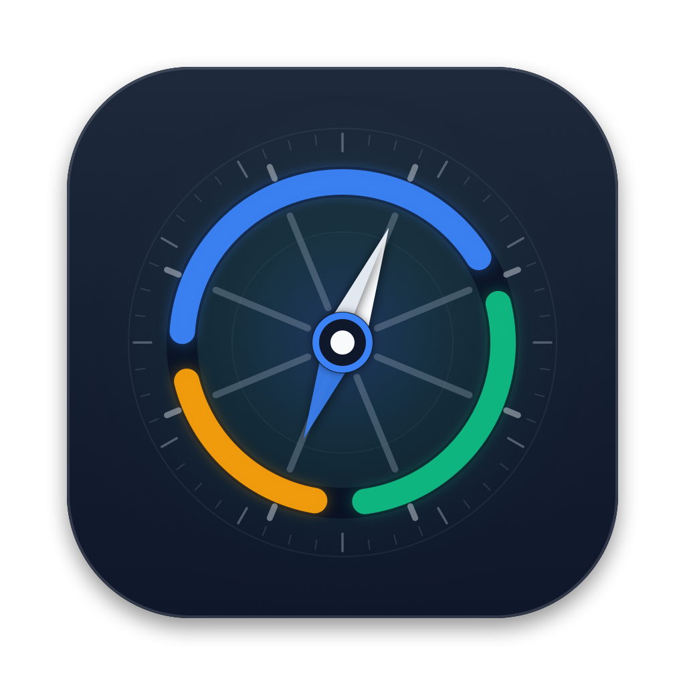

<div align="center">
  

  # DayHelm（日舵）

  **面向 macOS 的当日时间配额掌舵、设备端活动记忆与温和偏航校准工具**

  *掌舵今天的方向，在偏航时及时校准——而不是等明天对着报表懊悔。*

  [](Package.swift)
  [](Package.swift)
  [](#隐私与安全设计)
  [](#性能与资源占用)
  [](LICENSE)

  [**为什么做它**](#为什么需要-dayhelm) · [**核心特性**](#核心特性) · [**快速上手**](#快速上手) · [**CLI 与 AI Agent 接入**](#cli-与本地-http-api) · [**隐私设计**](#隐私与安全设计) · [**架构与测试**](#工程架构与验证)
</div>

---

## 为什么需要 DayHelm？

大多数效率与时间管理工具落在两个极端：

1. **事后统计型（被动记录）**：默默记录一整天，晚上或第二天生成一份漂亮报表，告诉你“今天切了 400 次窗口、核心任务只推进了 25 分钟”——但今天已经结束了，无法重来。
2. **强制封锁型（白名单锁死）**：一旦开启专注就强行屏蔽浏览器、拦截 `Cmd+Tab` 甚至全屏读秒。然而真实的知识工作（写代码查文档、做产品看表格、排查问题切终端与浏览器）**天然需要跨多个应用高频协同**，死板封锁只会不断打断正常心流。

**DayHelm（日舵）选择第三条路：在“今天当下”实时掌舵。**

它常驻 macOS 菜单栏，让你为每天真正重要的事设定**保底时长（Target）**，为容易失控的日常事务设定**封顶上限（Cap）**；在后台以极低开销理解你当前的窗口上下文，容许同一任务下的跨应用协同，只在**真正偏离主线、无意识高频乱切、或杂务超时**时，用右上角**不抢键盘焦点**的轻量卡片温和提醒你换挡。同时，它还能将本机活动轨迹与可选的离线屏幕 OCR 沉淀为开放的本地 SQLite 库，供你和你的本地 AI Agent 随时检索“刚才做到哪了”。

---

## 核心特性

### 1. 双向时间配额（Target 保底 + Cap 封顶）
- **保底目标（Target）**：为深度研发、写作、核心项目设定每日最低投入时长（如 `90m`），菜单栏实时显示推进进度，确保主线不被挤占。
- **封顶预算（Cap）**：为消息回复、工单处理、日常运营等容易吞噬全天的事务设定上限（如 `45m`），接近或达到上限时主动提醒收尾换挡。
- **一句话断点备注**：切换事项或暂停时可随手留下一句上下文备注（如 `停在鉴权中间件单测第 3 个用例`），回来时无缝衔接。

### 2. 理解跨应用协作的温和监督（零焦点抢占）
- **跨应用同任务容忍**：结合前台应用、Accessibility（AX）窗口标题、浏览器 URL 与事项关键词进行上下文分类——在 IDE、终端、文档与浏览器之间围绕同一项目切换时，计入连续有效专注，不会误报。
- **偏航与高频乱切识别**：通过滑动窗口识别无目标的高频横跳（Thrashing）与长时间项目偏离（Drift）。
- **`.nonactivatingPanel` 轻量提醒卡片**：所有提醒均以右上角浮动卡片呈现，**绝不抢夺当前正在输入代码的键盘焦点**；支持一键切换事项、`+15m` 延后收尾或转入休息。

### 3. 高密度精密仪表风（Precision Telemetry UI）
- **菜单栏实时胶囊**：等宽数字实时呈现当前航向（如 `● 核心研发 · 52/90m` 或 `▲ 日常杂务 · 45/45m`）。
- **`330pt` 免滚动主面板**：一屏集成快速事项切换器、双向预算进度条、采集与 OCR 状态栏，以及连续度微指标（今日最长连续块、近期切换热度、`≥12m` 有效深水区块数）。
- **今日时间光谱条（Day Spectrum Ribbon）**：采用四色语义系统（推进蓝 / 达标绿 / 封顶琥珀 / 乱切斜纹红）单画布渲染全天时间切片，一眼看清专注长块与碎片化时段。

```text
┌──────────────────────────────────────────────────────────┐
│  🧭 DayHelm                              [AX ●] [OCR ●]  │
│  ──────────────────────────────────────────────────────  │
│  专注中 · 核心架构重构                           42:18   │
│  当前窗口: Xcode — SpectrumBuilder.swift                 │
│  [● 核心架构]  [● 产品文档]  [● 日常沟通]  [⏸ 杂事/休息] │
│  📝 刚完成增量前缀缓存，下一步补齐边界测试               │
│  ──────────────────────────────────────────────────────  │
│  今日事项配额                       已投 112m · 达标 1/2 │
│  ● 核心架构重构 [专注中]                     62/90m  69% │
│    ██████████████████░░░░░░░░░                           │
│  ● 产品方案撰写                              30/30m 100% │
│    ███████████████████████████  ✓ 保底达标               │
│  ● 日常沟通与工单                            20/40m  50% │
│    █████████████░░░░░░░░░░░░░░                           │
│  ──────────────────────────────────────────────────────  │
│  今日时间光谱                              09:00 – 15:40 │
│  [███████████░░░████████▓▓▓██████░░░░█████████████████]  │
│  ┌──────────────┐ ┌──────────────┐ ┌──────────────────┐  │
│  │ 最长连续 48m │ │ 切换热度 18/h│ │ ≥12m 有效块 4 个 │  │
│  └──────────────┘ └──────────────┘ └──────────────────┘  │
└──────────────────────────────────────────────────────────┘
```

### 4. 设备端活动记忆与离线 Apple Vision OCR
- **完全独立运行**：内置原生焦点/键鼠活跃计次监听（不读取具体按键内容）、AX 窗口标题与主流浏览器当前标签页 URL 采集。
- **双重视觉去重快照 + 多语言离线 OCR（可选）**：授予可选的录屏权限后，通过 **32-bin 亮度直方图 + 缩略图像素差** 双重过滤无变化画面，仅在画面发生实质变化时保存去重快照并运行本机 Apple Vision OCR（默认支持简繁中文、英文、日文），写入 SQLite **FTS5（含 CJK Trigram）全文检索索引**。
- **自动分层存储与配额淘汰**：历史快照按时间自动降采样归档（Hot → Warm → Cold）并在超出保留天数或存储上限时自动清理图片文件，同时保留轻量文本索引。

### 5. 原生面向 AI Agent 开放（CLI & 本地 HTTP API）
- 无论是 Claude Code、Codex、Cursor 还是自定义脚本，都可以通过 `DayHelm` 命令行或本地环回 HTTP 接口（`127.0.0.1:24001`）即时查询当日专注目标、近期浏览过的文档 URL、窗口标题与屏幕 OCR 上下文，免去反复手动复制粘贴背景信息。

---

## 快速上手

### 环境要求
- **macOS 14.0 (Sonoma)** 及以上（推荐 Apple Silicon）
- **Swift 5.10+**（Xcode Command Line Tools 即可，无需打开 Xcode IDE）

### 方式一：30 秒无权限合成演示（推荐先试看界面）

无需授予任何系统权限，也不会读写本机任何个人数据，直接启动内置合成数据预览完整仪表盘、光谱条、提醒卡片与历史会话界面：

```bash
git clone https://github.com/lban2049/day-helm.git
cd day-helm

# 编译打包应用至 ./build/DayHelm.app
./scripts/build-app.sh

# 启动合成演示模式（零权限、零落盘）
./build/DayHelm.app/Contents/MacOS/DayHelm --synthetic-demo
```

### 方式二：安装至 `/Applications` 日常使用

```bash
# 编译 Release 版本、签名并安装到 /Applications/DayHelm.app 后自动启动
./scripts/install-app.sh --launch
```

启动后点击右上角菜单栏图标即可使用。权限采用**渐进式按需分级**，拒绝高阶权限仍可正常降级工作：

| 权限级别 | 系统权限 | 解锁能力 | 是否必需 |
|---|---|---|---|
| **L0 基础模式** | 无需任何权限 | 事项手动掌舵、双向配额计时、前台应用名识别、空闲检测 | 开箱即用 |
| **L1 标题与 URL** | 辅助功能（Accessibility） | 自动读取窗口标题、主流浏览器当前 URL、精准跨应用同任务识别 | 推荐开启 |
| **L2 深度视觉记忆** | 屏幕录制（Screen Recording） | 去重屏幕快照、本机离线 Apple Vision OCR、历史画面回溯与全文检索 | 可选开启，随时一键暂停 |

> **提示**：可以在命令行添加别名方便日常或 Agent 调用：
> ```bash
> alias dayhelm="/Applications/DayHelm.app/Contents/MacOS/DayHelm"
> ```

---

## CLI 与本地 HTTP API

DayHelm 采用单二进制双入口设计：无参数时作为菜单栏应用运行，带子命令时作为毫秒级响应的 CLI 工具直接输出结果。

### 命令行检索示例

```bash
# 查看当前专注状态、各项配额完成度与今日连续度指标（支持 --format md|json）
/Applications/DayHelm.app/Contents/MacOS/DayHelm status
/Applications/DayHelm.app/Contents/MacOS/DayHelm status --format json

# 获取最近 2 小时的完整工作上下文（直接喂给 AI Agent 了解你刚才在做什么）
/Applications/DayHelm.app/Contents/MacOS/DayHelm query --since 2h --format md

# 全文检索窗口标题、访问过的 URL 以及屏幕 OCR 识别出的文字
/Applications/DayHelm.app/Contents/MacOS/DayHelm search "SpectrumBuilder" --limit 10 --format json

# 按日期列出活动会话摘要，或按 ID 查看单次会话详情
/Applications/DayHelm.app/Contents/MacOS/DayHelm sessions --date 2026-11-18 --format md

# 彻底清理指定日期之前（或不带参数清理全部）的本地记录、数据库与快照
/Applications/DayHelm.app/Contents/MacOS/DayHelm purge --before 2026-11-01
```

### 本地环回 HTTP 接口（仅绑定 `127.0.0.1`）

应用运行期间默认监听 `http://127.0.0.1:24001`（若端口被占用则在 `24001–24009` 自动选择空闲端口，可在菜单栏面板状态栏查看当前端口）：

| 端点 | 说明 |
|---|---|
| `GET /api/dayhelm/context?since=2h` | 返回当前专注状态、事项预算进度、连续度指标与近期窗口/OCR 聚合上下文 |
| `GET /api/dayhelm/search?q=<keyword>&limit=20` | 跨窗口标题、URL、会话摘要与 OCR 文本执行全文检索 |
| `GET /api/activity-recorder/status` | 返回采集器运行状态、权限就绪情况与今日事件/快照/OCR 计数 |
| `GET /api/activity-recorder/sessions?limit=20&offset=0` | 分页查询录制会话列表（支持按日期与状态过滤） |
| `GET /api/activity-recorder/sessions/<id>` | 获取单次会话详情（含事件流、去重快照元数据与 OCR 帧，支持 6 位以上前缀匹配） |
| `GET /api/activity-recorder/digest?hours=24` | 生成指定时间窗口的结构化活动摘要 |

---

## 隐私与安全设计

DayHelm 是纯粹的**单人本机工具**，隐私边界在代码层硬性执行：

- **100% 本地存储，零网络外发**：不包含任何遥测、统计上报、崩溃收集或云端同步；HTTP 服务仅绑定 `127.0.0.1` 本地环回网卡。
- **绝不记录击键内容**：输入活跃度仅统计鼠标点击与按键发生的**次数与时间戳**以判断在场状态，绝不读取按键字符（`characters` / `keyCode`）、剪贴板、麦克风或摄像头。
- **敏感应用与场景自动熔断**：内置密码管理器（1Password、Bitwarden、Keychain、LastPass 等，支持在设置中自定义扩展 Bundle ID）、支付/网银/医疗关键词、私密聊天窗口与锁屏状态检测。一旦命中脱敏规则（`redacted == true`）或锁屏：**不保存窗口标题与 URL、不截屏、不运行 OCR**。
- **凭证与密钥自动掩码**：写入数据库前自动剥离 URL 中的敏感查询参数（`token`、`key`、`secret`、`sig`、`session` 等），并对文本中的 `Bearer` Token、`sk-...`、`ghp_...`、`AKIA...`、`AIza...`、JWT、PEM 私钥块及通过 Luhn 校验的银行卡号自动打码。
- **一键彻底销毁**：执行 `dayhelm purge` 即可物理删除全部 SQLite 数据库、JSON 状态与屏幕快照目录。

详细策略请参阅 [docs/privacy.md](docs/privacy.md)。

---

## 性能与资源占用

作为全天候常驻菜单栏的工具，DayHelm 针对 macOS 后台能效与内存水位做了深度收敛（Apple Silicon 实测）：

| 指标 | 实测表现 | 技术机制 |
|---|---|---|
| **稳态物理内存** | **`~24 MB`**（峰值 `< 50 MB`） | 守护主进程零 Vision 模型驻留；历史窗口缩略图经 `ImageIO` 按需下采样，关闭窗口即销毁视图树与图片缓存 |
| **稳态后台 CPU** | **`0.0% – 0.3%`** | 菜单栏面板收起时完全卸载隐藏 SwiftUI 视图树；增量时间光谱前缀缓存 + $O(1)$ 滑动窗口检测 |
| **无头 OCR 子进程隔离** | 空闲自动归零 | Vision OCR 运行于无 AppKit 的轻量无头子进程，处理完批次或空闲 `15s` 后自动退出，将神经网络框架内存 `100%` 归还系统 |

架构取舍详见 [ADR 011: CPU 与内存性能收敛](docs/decisions/011-cpu-and-memory-performance-convergence.md)。

---

## 工程架构与验证

项目采用纯 Swift Package Manager 组织，严格分离核心纯逻辑、系统采集服务与原生界面：

```text
Package.swift
├── Sources/DayHelmCore/      # 纯逻辑引擎、双向配额、滑动窗口分类、SQLite3 (FTS5/WAL)、CLI（严禁 import AppKit/SwiftUI）
├── Sources/DayHelmCapture/   # AX 窗口与浏览器内省、ScreenCaptureKit 去重快照、无头 Vision OCR、本地环回 HTTP 服务
├── Sources/DayHelmApp/       # MenuBarExtra 精密仪表盘、单 Canvas 时间光谱条、非激活提醒 HUD、设置与历史会话窗口
├── Sources/DayHelmChecks/    # 无 GUI/无网络可运行的确定性自检套件
└── Tests/DayHelmCoreTests/   # 单元测试、并发 WAL 压力测试与全链路端到端测试
```

运行全量四阶段验证（架构边界检查 + 零警告编译 + 确定性自检 + `swift test`）：

```bash
./scripts/run-tests.sh
```

### 延伸文档
- [产品需求与设计目标](docs/requirements.md)
- [系统架构与数据流规范](docs/architecture.md)
- [隐私边界与权限说明](docs/privacy.md)
- [架构决策记录（ADRs）](docs/decisions/README.md)

---

## 开源许可

本项目基于 [MIT License](LICENSE) 开源。
